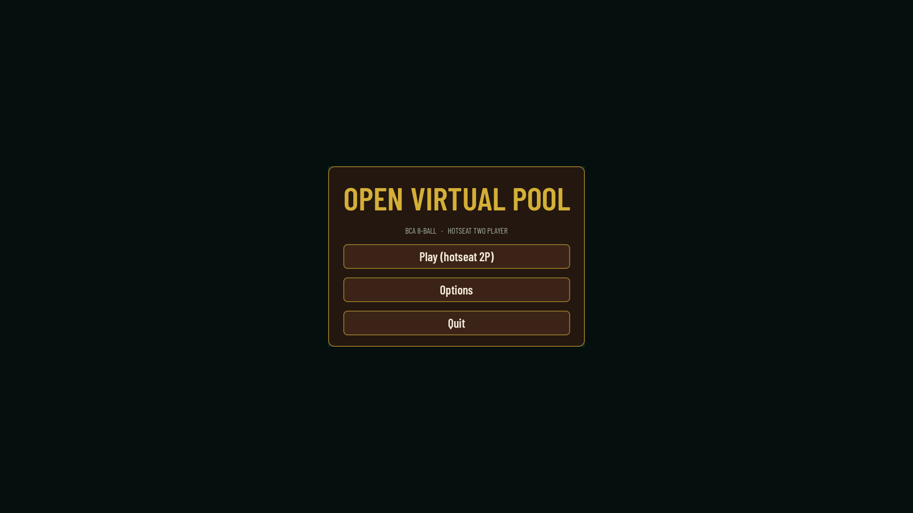
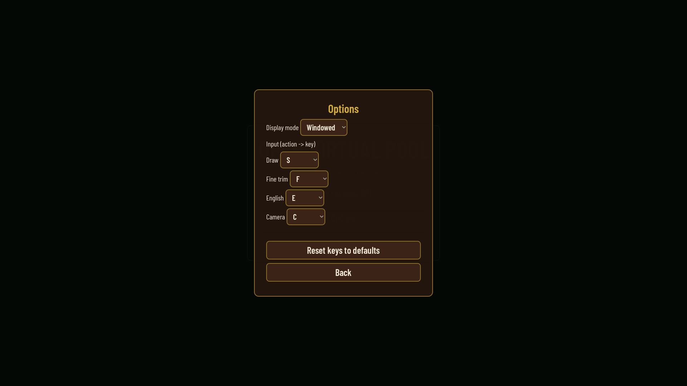
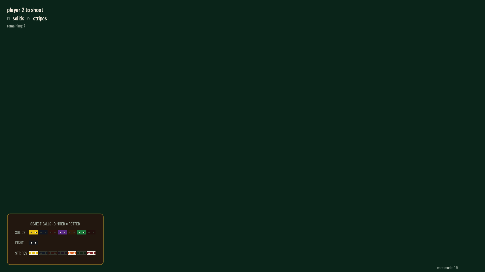
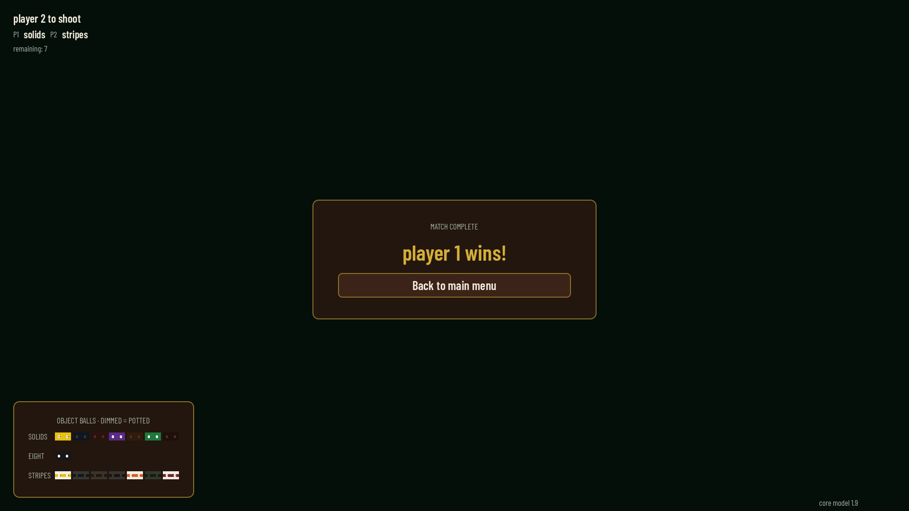

# Open Virtual Pool

A deterministic 8-ball pool game on the virtual pool physics core. The Rust
core in [`Virtual-Pool-Physics-Engine`](https://github.com/krunoo53k/Virtual-Pool-Physics-Engine)
is the only physics: one call resolves a shot into a path; Godot samples the
path and draws it. GDScript never simulates.

## Dev run

The game consumes the engine repo's `pool-godot` build. Nothing in this repo
holds a compiled library; `bin/*.so` is gitignored.

```sh
# from the sibling engine repo
cd ../Virtual-Pool-Physics-Engine
./godot-project/build-extension.sh release
cp godot-project/bin/libpool_godot.so ../Open-Virtual-Pool/bin/

# from this repo: boots the menu (the configured main scene)
godot --path . # (editor, 4.7)
```

Headless smoke of the bridge — loads the extension, fires the pinned shot and
checks the golden hash (`c399229b25faae5a`) — exits 0 when it agrees:

```sh
godot --headless --path . scenes/smoke.tscn
```

The `VersionStamp` scene prints and shows `PoolCore.get_model_version` (1.8) on
any running screen, so the loaded extension can be identified while playing.

## Self-play smoke

Drive one full eight-ball game with both seats controlled by the same scripted
policy through the public `take_shot` entry — real physics, rules, rack and turn
flow; only shot selection is scripted:

```sh
godot --headless --path . res://tools/self_play.tscn
```

It prints a shot-by-shot transcript and saves it to
`user://self_play_transcript.txt`. Exit 0 means the match reached a winner with
no harness failure.

## Run the menu

`scenes/main_menu/main_menu.tscn` is the configured main scene: plain
`godot --path .` shows a boot splash and then the title screen. It also stands
alone if you want to launch it explicitly:

```sh
godot --path . res://scenes/main_menu/main_menu.tscn
```

- **Play (hotseat 2P)** navigates to `res://scenes/match/match.tscn`. That
  scene arrives with the match-flow work; until it is present the menu prints
  a clear message and stays where it is instead of erroring.
- **Options** opens the display/input panel. *Display mode* picks windowed or
  fullscreen (a no-op in headless runs). The action → key rows rebind the
  InputMap actions declared in `scripts/helpers/input_actions.gd`; **Back**
  returns to the title.
- **Quit** exits with code 0.

Display mode and the key bindings are saved to `user://open_virtual_pool.cfg`
(`[display] fullscreen`, and `[input]` with one label per action). The file is
written on the first change and read again whenever the menu starts.

The two headless acceptance commands both exit 0 when the splash, buttons,
Play target, config round-trip and Quit path hold:

```sh
godot --headless --path . res://tools/main_menu_test.tscn
godot --headless --path . res://tools/menu_quit_test.tscn
```

## Controls

Hold **M** and move the mouse to place the cue ball after a foul. Releasing M
stops the drag, but the spot is not locked in until the shot: the ball can be
moved again while lining up the stroke. A scripted `place_at` still commits
immediately, so AI and netcode callers keep the old contract.

The mouse turns the shot line, **F** fine-trims the turn, **E** holds English,
**S** draws the cue and shoots when it comes home, **B** raises the butt,
**C** switches camera, **L** dumps the last shot and **Escape** pauses.

## Debug: last-shot log

During a match, press **L** to write the last resolved shot to
`user://last_shot.json`. Godot prints the full path to stdout (on Linux:
`~/.local/share/godot/app_userdata/Open Virtual Pool/last_shot.json`). Each
press overwrites the file with the most recent shot.

The snapshot is taken the moment the core resolves the stroke, before the rack
is folded forward to its final frame, so it holds the layout that actually
produced the bug. It is pretty-printed JSON with:

- `model_version` and `player` — which bridge and shooter were live;
- `params` — the exact stroke: speed, aim, elevation, tip offset, called pocket;
- `rack_before` — every ball's number, position and rotation before the shot;
- `shot` — the core's `hash` (the determinism pin) and path duration;
- `outcome` — phase, elapsed time, foul/miscue, pocketed and off-table balls, error;
- `events` — the core's events in order, in ball-number terms.

Paste that file when reporting a bugged shot: the params plus `rack_before`
replay the same core call, and the hash says whether it reproduced. Floats are
written at full precision so the hash is byte-exact. The bind is checked
headlessly with:

```sh
godot --headless --path . res://tools/shot_log_test.tscn
```

## UI theme and resolution checks

All `Control` nodes inherit `resources/ui_theme.theme` (set in `project.godot`):
a vendored Barlow Condensed OFL font (regular + semibold, licence in
`assets/fonts/OFL.txt`), a walnut/brass/felt palette, and `Title`, `Heading`,
`Status`, `Caption` and `GroupTag` label variations. Regenerate the theme with
`godot --headless --path . --script tools/build_ui_theme.gd`. The UI is authored
at a 1920×1080 reference viewport; `window/stretch/mode = "canvas_items"` with
`aspect = "keep"` scales it to any 16:9 window. The HUD's ball tracker shows all
fifteen object balls by group and dims the potted ones from `MatchState.remaining`.

`tools/ui_layout_test.tscn` checks the real menu and HUD for clipping,
off-screen controls, applied font and potted-ball state. Run it headless at the
reference size, or on X11 at each target resolution:

```sh
godot --headless --path . res://tools/ui_layout_test.tscn -- --width=1920 --height=1080
godot --path . --display-driver x11 --rendering-driver vulkan --windowed --resolution 1920x1080 \
  res://tools/ui_layout_test.tscn -- --width=1920 --height=1080
godot --path . --display-driver x11 --rendering-driver vulkan --windowed --resolution 1366x768 \
  res://tools/ui_layout_test.tscn -- --width=1366 --height=768
# 1440p is the native fullscreen size here:
godot --path . --display-driver x11 --rendering-driver vulkan --fullscreen \
  res://tools/ui_layout_test.tscn -- --width=2560 --height=1440
```

## Screenshots

`tools/ui_capture.tscn` renders four screens (title, options, match HUD, pause)
at three resolutions into `docs/screenshots/`. Use the Vulkan renderer — the
project is Forward+ and OpenGL frames come out blank. Run with an isolated
`XDG_DATA_HOME` so a saved `fullscreen=true` cannot override the requested
window size:

```sh
godot --path . --display-driver x11 --rendering-driver vulkan --windowed --resolution 1920x1080 \
  res://tools/ui_capture.tscn -- --screen=title --out=/abs/path/docs/screenshots/title_1080p.png
godot --path . --display-driver x11 --rendering-driver vulkan --fullscreen \
  res://tools/ui_capture.tscn -- --screen=match --fullscreen --out=/abs/path/docs/screenshots/match_1440p.png
```

<p align="center"></p>
<p align="center"><em>Title screen — Play, Options, Quit.</em></p>

<p align="center"></p>
<p align="center"><em>Options — display mode and the four rebindable actions.</em></p>

<p align="center"></p>
<p align="center"><em>Match HUD — turn status and the ball tracker, with four balls potted.</em></p>

<p align="center"></p>
<p align="center"><em>Game over — centred result panel with a Back to main menu button.</em></p>

The result panel's button emits the same menu intent as the pause menu;
`tools/result_banner_test.tscn` pins its text, backdrop and intent headlessly.

## Art assets

The table cloth and slate (with the six pocket openings cut through), black
pocket throats with thin leather facings, a walnut rail/frame with the long
rails split at the side pockets, the ball sphere and all 21 textures are
generated in Blender from the same geometry numbers `TableLayout` carries.
The pocket openings are also cut through the decorative apron so nothing shows
through the throat. The hole sizes come from the pocket region, not from a
photograph: a corner hole is centred on the drop point with a radius equal to
the 44.45 mm shelf depth, so its near edge is the mouth line and its centre is
the drop line — a ball looks over the hole exactly when it is in the pocket
region, and disappears when the core drops it. Side pockets have a 6.35 mm
shelf, so their jaw-tip half-width at the mouth centre is already honest.
The wooden rails are offset outward from the cushion noses:
originally both boxes shared a top and an inner face, which z-fought along every
rail. The cushions themselves keep the core's exact positions and spans. The source scene
and generator live in `tools/blender/`:

```sh
blender -b --python tools/blender/build_pool_assets.py
godot --headless --path . --import
```

`.blend` source lives under `tools/blender/`, whose `.gdignore` keeps Godot
from trying to import it.
The generated `.obj` meshes, `.png` textures and their `.import` sidecars are
committed, so headless runs need no Blender install. The spec-pinned rail,
cushion, pocket and jaw node names and transforms in `scenes/table/` are
unchanged — only their meshes and materials were replaced.

## Layout

- `project.godot` — Godot 4.7, Forward+; the extension targets api-4.6
  (`compatibility_minimum = 4.6`).
- `bin/pool_godot.gdextension` — the manifest; the built `.so` beside it stays
  gitignored.
- `scenes/main.tscn` — the boot scene: a bare table stand-in plus `VersionStamp`.
- `scenes/smoke.tscn` — the bridge smoke test with the pinned golden hash.
- `.hermes/skills/godot-composition/` — the repo-local composition skill;
  `scripts/lint_composition.py` must stay at zero errors.
